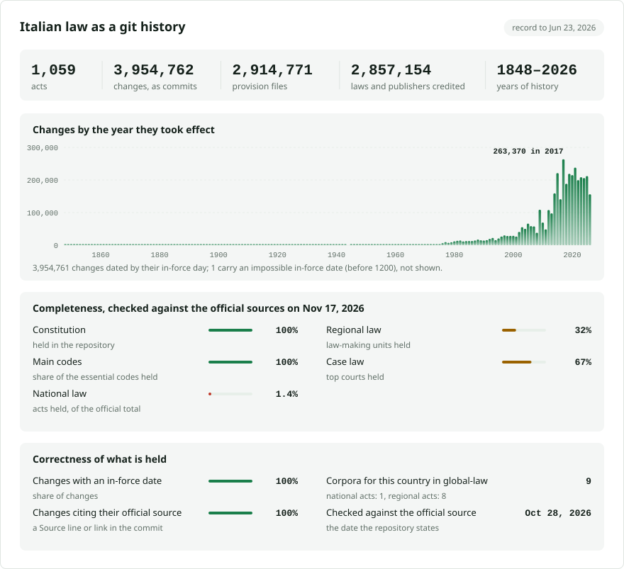

# Italy: law history in git

**English** · **[Oppure leggilo in italiano](README.md)**

<picture>
<source media="(prefers-color-scheme: dark)" srcset="data/effort-dark.svg">

</picture>

The law of Italy as a git history: one file per article, one commit for each change on the day it took effect, and the act that made the change as the commit's author. `git blame` names the act behind every paragraph; `git log` lists every change to an article; picking a date gives the text in force that day.

Part of [lexifina/global-law](https://github.com/lexifina/global-law), one git history for every country's law: this is Italy's national law, which global-law reads at `italy/national/acts/`.

**What is in it now:** the Constitution (28 versions since 1948) and 54 laws (the 50 leggi costituzionali and four much-amended statutes) with every version Normattiva publishes; 22,441 Corte costituzionale decisions of 1956–2026 (details and a link to the official text) and their 46,607 official massime in full, from the Court's open data (CC BY-SA 3.0), in [`giurisprudenza/corte-costituzionale/`](giurisprudenza/corte-costituzionale/). The core codes (civil, penal, civil and criminal procedure) are not here yet: their official sources (Normattiva, Gazzetta Ufficiale) are blocked or need a session. [`REPRODUCE.md`](REPRODUCE.md) lists every act with its folder and versions; [`atti.csv`](atti.csv) lists the amending acts with all their dates.

Each act is in `<kind>/<year>/<number>/`, one file per article (`legge/1970/300/art-018.md` is art. 18 of the Statuto dei lavoratori, Legge 20 maggio 1970, n. 300); the Constitution is [`costituzione/`](costituzione/), with its transitional and final provisions in `costituzione/allegati/`.

The text is in Italian, as Normattiva publishes it, with its `(( ))` marks around amended words and its update notes. An English translation is not part of this record.

## Questions as git commands

| Question | Command |
| --- | --- |
| Every change to art. 18 of the Statuto dei lavoratori | `git log -p --word-diff -- legge/1970/300/art-018.md` |
| Which act wrote each line of art. 18? | `git blame legge/1970/300/art-018.md` |
| Every version of the Statuto dei lavoratori, with the day each took effect | `git log --format="%h %(trailers:key=In-force,valueonly,separator=) %an" -- legge/1970/300` |
| Art. 18 as in force on 1 January 2012 | `python tools/vigente.py 2012-01-01 legge/1970/300 18` |

**Outside git**, we also host this record publicly, for free:

- **[Ask Claude about Italian law](https://global-law.lexifina.com/v1/try_claude?country=italy)**: opens Claude with a first question ready.
- **[Ask ChatGPT](https://global-law.lexifina.com/v1/try_chatgpt?country=italy)**: the same question in ChatGPT.
- **[Search Italian law on our site](https://lexifina.com/law?country=italy&q=ferie+annuali)**: a search for "ferie annuali", with each provision's text and its versions, no account needed.
- **[Developer REST API](https://global-law.lexifina.com/v1/search_law?query=ferie+annuali&jurisdiction=italy)**: the same search as JSON, with no key. See the [documentation here](https://lexifina.com/api/global-law).

Both assistants read the record through the free Global law connector (MCP, `https://global-law.lexifina.com/mcp`); the first time, the chat gives you the link that adds it. Ask in Italian or in English.

**Host it yourself easily.** All it takes is git and Python, and the tools run on your machine:

```sh
git clone --depth 1 https://github.com/lexifina/global-law && cd global-law
python3 tools/countries.py add italy/national/acts
python3 tools/law.py show 2026-01-01 italy/national/acts/legge/1970/300/art-018.md
```

Opened in Claude Code, Cursor, VS Code or Codex, the clone also starts a local MCP server with the same tools ([MCP.md](https://github.com/lexifina/global-law/blob/main/MCP.md)).

## Dates

Each commit is dated at noon, Europe/Rome, on the day the change took effect, and carries it in its `In-force:` trailer (with `Enacted:` and `Published:`):

- the day is the one Normattiva gives as the start of the version ("vigenza dal"); where two versions start on the same day, the later one is that day's text;
- git cannot store dates before 1970, so the 23 commits in force earlier (the Constitution of 1948, its revisions up to 1967, the first statutes of the special regions) are dated 1 January 1970, one second apart in the order they took effect, with the real day in `In-force:`. Ask for a date with `tools/vigente.py`, not `git log --before`.

Each change is credited to the act that Normattiva's per-article record names (`Legge 92/2012`, `D.L. 248/2007`), with an address that cannot exist (`legge-2012-92@normattiva.invalid`); Constitutional Court judgments that struck words out are credited too (`Corte costituzionale, sentenza 59/2021`), and a decree-law is credited under its own number even where its conversion law made the change. Changes no record explains (6 commits), or that two acts could have made (4, naming them in `Candidate:` trailers), are committed by `Normattiva (IPZS)` and credited to no act.

## How it is checked

- `tools/check_repo.py` reads every version of every act back from git on the day it took effect and compares it with Normattiva's Akoma Ntoso file for that version, byte for byte with the text it renders to and word for word with every word of the XML: 340 versions, 0 mismatches.
- A second build from the same data into an empty folder gave the same hash for every commit and tag.
- `tools/test_repo.py` checks that blame, the dated tool, the tags and the `In-force:` trailers work. The results are in [`REPRODUCE.md`](REPRODUCE.md).
- [vulnerabilities/](vulnerabilities/README.en.md): possible drafting mistakes in this law, found by global-law's detectors and checked by hand. Not run yet.

## What it does not show

- **Most Italian law.** Only these 55 acts are here: not the codes (civil, criminal, procedure) or other statutes. The same build works for any act Normattiva Open Data exports.
- **Changes after 28 October 2026**, the day the data was retrieved.
- **Versions Normattiva does not publish.** Each act starts with its text as published (the "originale").
- **Changes in meaning without a change in words**: a judgment, a transitional rule elsewhere or a later interpretation can change what a provision means; Normattiva's notes record some of these.
- **Regional law and case law.** The regions' laws are in their own repositories in global-law (`italy/<region>/acts/`); Constitutional Court judgments appear only where they changed the text.

## Sources

| Source | Kind | Past versions | Notes |
| --- | --- | --- | --- |
| [Normattiva Open Data](https://dati.normattiva.it) (Istituto Poligrafico e Zecca dello Stato) | Consolidated text "in multivigenza", Akoma Ntoso and JSON | yes, every version from the originale | The JSON gives the per-article record of amending acts; not the official text, which is the Gazzetta Ufficiale in print |

## Licence

See [`LICENSE`](LICENSE). The data comes from Normattiva Open Data under CC BY 4.0, which since 1 January 2026 covers every act on Normattiva in all its versions; attribution: **Fonte: Normattiva (www.normattiva.it) - Istituto Poligrafico e Zecca dello Stato S.p.A., dati.normattiva.it, licenza CC BY 4.0. Testo non ufficiale e a titolo gratuito.** The whole repository is released under CC BY 4.0 with the same attribution.

No AI model wrote or changed legal text; the scripts were written by an AI model (see [`REPRODUCE.md`](REPRODUCE.md)).

## Visualisations

- [visualisations/](visualisations/README.en.md): charts drawn from this repository. Not drawn yet.

## More

From [lexifina/global-law](https://github.com/lexifina/global-law):

- [FEATURES.md](https://github.com/lexifina/global-law/blob/main/FEATURES.md): every feature, and what every corpus must support (`git blame`, `law.py`, the MCP tools)
- [FAQ.md](https://github.com/lexifina/global-law/blob/main/FAQ.md): questions and answers · [CONTRIBUTING.md](https://github.com/lexifina/global-law/blob/main/CONTRIBUTING.md): proposing changes · [MCP.md](https://github.com/lexifina/global-law/blob/main/MCP.md): the MCP server · [REPRODUCE.md](https://github.com/lexifina/global-law/blob/main/REPRODUCE.md): how it was built · [CHANGELOG.md](https://github.com/lexifina/global-law/blob/main/CHANGELOG.md)
- [FRESHNESS.md](https://github.com/lexifina/global-law/blob/main/FRESHNESS.md): how current each corpus is · [Monitoring](https://github.com/lexifina/global-law/tree/main/monitoring): whether updates are running · [WATCHING.md](https://github.com/lexifina/global-law/blob/main/WATCHING.md): how each official source is watched for changes
- [performance/](https://github.com/lexifina/global-law/tree/main/performance): how fast the tools are, measured
- [visualisations/](https://github.com/lexifina/global-law/tree/main/visualisations): charts and bridges across the world's law
- [Vulnerabilities](https://github.com/lexifina/global-law/tree/main/vulnerabilities): mistakes in legislation as published
