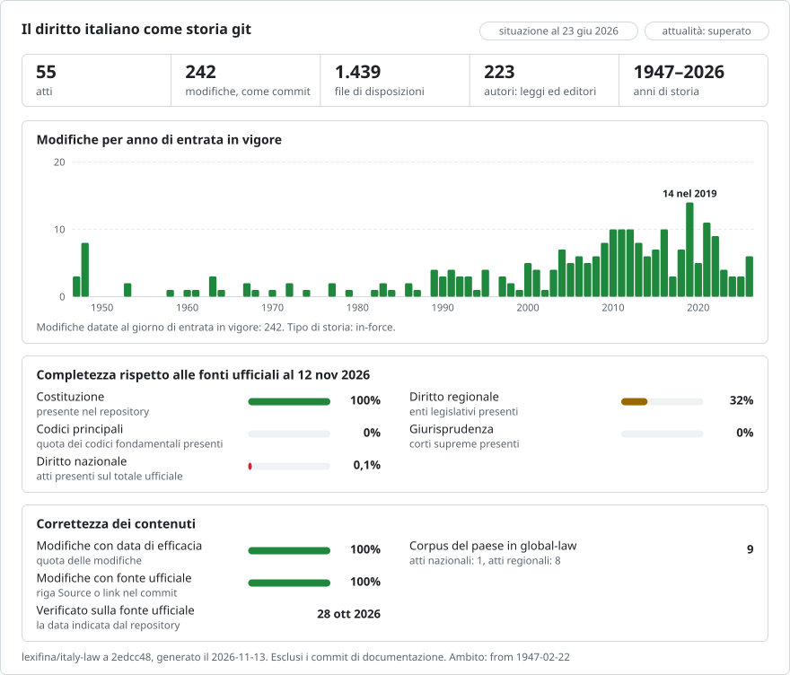

# Il diritto italiano, modifica per modifica

**Italiano** · [English](README.en.md)

<picture>
<source media="(prefers-color-scheme: dark)" srcset="data/it/effort-dark.svg">

</picture>

Fa parte di [lexifina/global-law](https://github.com/lexifina/global-law), un'unica storia git per il diritto di ogni Paese: questo è il diritto nazionale italiano, che global-law legge in `italy/national/acts/`.

La Costituzione della Repubblica Italiana, tutte le leggi costituzionali e quattro testi più volte modificati, come
repository git: lo Statuto dei lavoratori (Legge 300/1970), la legge sul procedimento amministrativo (Legge
241/1990), il Codice in materia di protezione dei dati personali (D.Lgs. 196/2003) e il Codice dell'amministrazione
digitale (D.Lgs. 82/2005). Ogni atto modificativo è un commit, attribuito a quell'atto e datato al giorno in cui la
modifica è entrata in vigore, a mezzogiorno ora di Roma. Il testo è quello consolidato di Normattiva "in multivigenza"
(tutte le versioni nel tempo), tratto da Normattiva Open Data.

## Le domande, come comandi git

| Domanda | Comando |
| --- | --- |
| Che cosa diceva l'art. 117 della Costituzione il 1º gennaio 2000? | `python tools/vigente.py 2000-01-01 costituzione 117` |
| L'intera Costituzione com'era in vigore il 1º gennaio 2023 | `python tools/vigente.py 2023-01-01 costituzione` |
| L'art. 13 del codice della privacy al 1º giugno 2015 | `python tools/vigente.py 2015-06-01 decreto-legislativo/2003/196 13` |
| Quale atto ha scritto ciascuna riga dell'art. 117? | `git blame costituzione/art-117.md` |
| Tutte le modifiche all'art. 9 della Costituzione, con l'atto e il giorno | `git log --follow costituzione/art-009.md` |
| Tutto ciò che un atto ha modificato | `git show --stat atto/legge-costituzionale-2001-3` |
| La Costituzione nel giorno in cui una revisione è entrata in vigore | `git show --stat costituzione/2022-03-09` |
| Tutti gli atti che hanno modificato la Legge 241/1990 nel 2005 | `git log --format="%ad %an" --date=short --since=2005-01-01 --until=2005-12-31 -- legge/1990/241` |
| Le sentenze della Corte costituzionale che hanno modificato il testo | `git log --format="%ad %an | %s" --date=short --author=sentenza` |
| Le modifiche che nessun atto spiega, o che due atti potrebbero aver apportato | `git log --format="%ad %s" --date=short --author=Normattiva` |
| Le modifiche attribuite solo in base alla data | `git log --format="%h %an | %s" --grep="Evidence: .*by date only"` |
| Gli atti modificativi con tutte le loro date | [`atti.csv`](atti.csv) |

## Le date, e quale usiamo

Un atto italiano ha il giorno in cui è stato emanato (`Enacted:`), il giorno in cui è stato pubblicato nella Gazzetta
Ufficiale (`Published:`) e il giorno in cui la modifica è entrata in vigore (`In-force:`). **I commit sono datati al
giorno in cui la modifica è entrata in vigore**, a mezzogiorno ora di Roma: è il giorno che Normattiva indica come
inizio della versione ("vigenza dal"). Tutte le date sono riportate in ogni messaggio di commit. Git non può registrare
una data anteriore al 1970: i commit in vigore prima di allora (la Costituzione dal 1948, le sue revisioni fino al
1967, i primi statuti regionali) sono datati 1º gennaio 1970, a un secondo di distanza l'uno dall'altro nell'ordine in
cui sono entrati in vigore, e il giorno effettivo è in `In-force:`. Gli strumenti devono leggere `In-force:`, come fa
`tools/vigente.py`.

Le date semplici passate a `--since`, `--until` e `--before` di git sono interpretate nel fuso orario locale; i commit
sono a mezzogiorno ora di Roma, quindi la modifica di un giorno ricade in quel giorno ovunque, ma per un taglio esatto
si indichi un orario completo, `--before="2022-03-09T23:59:59+01:00"`. In PowerShell, `$(...)` dentro
`git show $(...):path` viene diviso in due argomenti; si usi `$r = git rev-list -1 ...; git show "$($r):path"`.

Un tag indica lo stato di ciascun atto in ogni giorno in cui è cambiato (`costituzione/2022-03-09`,
`legge/1990/241/2005-03-08`) e il primo commit di ciascun atto modificativo (`atto/legge-costituzionale-2022-1`,
`atto/sentenza-2025-156`). Dopo una ricostruzione di questo repository, eseguire il fetch con
`git fetch --force --tags`: un fetch semplice mantiene i tag vecchi.

## Che cosa significa "autore"

L'autore di un commit è l'atto che ha apportato la modifica: `Legge costituzionale 1/2022`, `D.L. 207/2008`,
`D.Lgs. 101/2018`, con un indirizzo che termina in `@normattiva.invalid`, che non può esistere, così `git blame`
indica l'atto. Sono autori anche le sentenze della Corte costituzionale che hanno eliminato parole del testo
(`Corte costituzionale, sentenza 231/2013`, `@cortecostituzionale.invalid`), così come le correzioni pubblicate nella
Gazzetta Ufficiale (errata corrige, avvisi di rettifica), che sono indicate come correzioni, non come modifiche. Un
decreto-legge è attribuito con il proprio numero anche quando la sua legge di conversione lo ha modificato; Normattiva
registra la coppia sotto il decreto-legge.

Come viene attribuita una modifica, ciascun caso indicato nel trailer `Evidence:` del commit:
- **Il dato di Normattiva per articolo.** Per ogni articolo di ogni versione, l'export JSON di Normattiva elenca le
  disposizioni di altri atti che hanno prodotto la formulazione vigente dell'articolo ("articoliAggiornanti"), con il
  giorno da cui quella formulazione si applica. Quando l'articolo è cambiato in questa versione, quella formulazione
  decorre da questo giorno ed è indicato un solo atto, la modifica è di quell'atto. Se sono indicati due atti della
  stessa Gazzetta, il loro codice redazionale li distingue.
- **Solo in base alla data.** Un articolo non coperto dal dato di Normattiva (una disposizione inserita, abrogata o
  rinumerata, un allegato), in una versione la cui cronologia degli aggiornamenti aggiunge esattamente un atto:
  quell'atto.
- Le unità senza dato per articolo (il titolo, il preambolo, le intestazioni della struttura) in una versione le cui
  modifiche registrate provengono tutte da un solo atto: quell'atto.

Una modifica che nessun dato spiega è registrata nel commit da `Normattiva (IPZS)`, indicata come "modifica senza atto"
e non attribuita ad alcun atto. Se sono possibili due o più atti è indicata come "atto non determinato" e li nomina nei
trailer `Candidate:`. Se è cambiata solo la presentazione di Normattiva (i segni `(( ))` che pone intorno alle parole
modificate, la spaziatura, le maiuscole e minuscole) il commit è indicato come "redazionale" (`Editorial: yes`). Il
committer è sempre `Lexifina`.

## Come viene verificato

`tools/check_repo.py` rilegge da git ogni versione di ogni atto nel giorno in cui è entrata in vigore e la confronta
con i dati ufficiali: file per file, byte per byte, con il testo che si ottiene dal file Akoma Ntoso della versione, e
parola per parola con ogni parola di quell'XML, letto indipendentemente dal renderer. Come ulteriore verifica confronta
le parole con l'export JSON di Normattiva della stessa versione. `tools/test_repo.py` verifica che i comandi sopra
funzionino. I risultati sono in [`REPRODUCE.md`](REPRODUCE.md).

## File

Ogni atto è una cartella denominata con il tipo, l'anno e il numero (`legge/1990/241/`,
`decreto-legislativo/2003/196/`, `legge-costituzionale/2001/3/`); la Costituzione è `costituzione/`. Ogni articolo è
un file denominato secondo l'identificativo di Normattiva: `art-117.md` è `art_117`, `art-002-quater.md` è
`art_2-quater`. La prima riga è il numero dell'articolo, poi la rubrica, poi una riga per ogni comma, lettera e numero.
Le note di Normattiva sull'articolo ("AGGIORNAMENTO (5)", i richiami `((5))`) restano dove Normattiva le stampa, alla
fine dell'articolo, e i segni `(( ))` intorno alle parole modificate sono mantenuti come li stampa Normattiva.
`intestazione.md` contiene il titolo e la nota di Normattiva sull'entrata in vigore, `preambolo.md` la formula di
promulgazione, `conclusioni.md` le sottoscrizioni, `allegati/` gli allegati (le disposizioni transitorie e finali
della Costituzione sono da `allegati/allegato-i.md` a `allegato-xviii.md`), e `struttura.md` le intestazioni di
parti, titoli, capi e sezioni, con il primo articolo di ciascuna. La spaziatura è ridotta a spazi singoli; nessuna
parola è modificata.

## Che cosa non mostra

- Le versioni che Normattiva non pubblica. La storia di ogni atto parte dal testo come pubblicato (l'"originale"), in
  vigore dal giorno indicato da Normattiva.
- Quale di due atti abbia apportato una modifica quando il dato di Normattiva non permette di stabilirlo (sopra).
- Parole invariate non significano diritto invariato: una sentenza, una norma transitoria altrove o l'interpretazione
  data da un atto successivo possono cambiare il significato di una disposizione senza cambiarne le parole. Le note di
  Normattiva registrano alcuni di questi casi.
- Qualsiasi atto oltre a questi. La stessa procedura di costruzione funziona per qualsiasi atto esportato da
  Normattiva Open Data: basta aggiungerlo a `SOURCES` in `tools/build.py`.

Il testo di Normattiva non è il testo ufficiale: "L'unico testo ufficiale e definitivo è quello pubblicato sulla
Gazzetta Ufficiale Italiana a mezzo stampa, che prevale in casi di discordanza."

## Come viene costruito

`tools/build.py` scarica gli export tramite l'API di Normattiva Open Data e scrive questo repository da zero; gli
stessi dati danno gli stessi hash. Ogni passaggio, il software, le decisioni prese a mano e ciò che ha fatto un
modello di IA sono in [`REPRODUCE.md`](REPRODUCE.md). La cartella di ogni atto ha un `README.md` che ne elenca le
disposizioni con il numero di volte in cui ciascuna è cambiata. [`corpus.json`](corpus.json) descrive il corpus per
gli strumenti che leggono più repository giuridici di Lexifina.

## Licenza

I dati provengono da Normattiva Open Data e sono utilizzati in base alla licenza Creative Commons Attribuzione 4.0
Internazionale (CC BY 4.0), che dal 1º gennaio 2026 copre tutti gli atti presenti su Normattiva nelle versioni
originale, vigente a una data e multivigente. Attribuzione: **Fonte: Normattiva (www.normattiva.it) - Istituto
Poligrafico e Zecca dello Stato S.p.A., dati.normattiva.it, licenza CC BY 4.0. Testo non ufficiale e a titolo
gratuito.** Modifiche apportate: il testo consolidato di ogni versione è suddiviso in un file per disposizione con la
spaziatura normalizzata, e le versioni sono registrate come commit git attribuiti agli atti che le hanno prodotte.
L'intero repository è rilasciato con licenza [CC BY 4.0](LICENSE) con la stessa attribuzione.

Questa è una traduzione della versione inglese ([README.en.md](README.en.md)); in caso di differenze, prevale la versione inglese.

## Per saperne di più

Dal repository [lexifina/global-law](https://github.com/lexifina/global-law) (pagine in inglese):

- [FEATURES.md](https://github.com/lexifina/global-law/blob/main/FEATURES.md): tutte le funzionalità e ciò che ogni corpus deve supportare (`git blame`, `law.py`, strumenti MCP)
- [FAQ.md](https://github.com/lexifina/global-law/blob/main/FAQ.md): domande e risposte · [CONTRIBUTING.md](https://github.com/lexifina/global-law/blob/main/CONTRIBUTING.md): proporre una modifica · [MCP.md](https://github.com/lexifina/global-law/blob/main/MCP.md): server MCP · [REPRODUCE.md](https://github.com/lexifina/global-law/blob/main/REPRODUCE.md): come è stato realizzato · [CHANGELOG.md](https://github.com/lexifina/global-law/blob/main/CHANGELOG.md)
- [FRESHNESS.md](https://github.com/lexifina/global-law/blob/main/FRESHNESS.md): quanto è aggiornato ogni corpus · [Monitoraggio](https://github.com/lexifina/global-law/tree/main/monitoring): se gli aggiornamenti funzionano · [WATCHING.md](https://github.com/lexifina/global-law/blob/main/WATCHING.md): come ogni fonte ufficiale viene controllata per individuare le modifiche
- [performance/](https://github.com/lexifina/global-law/tree/main/performance): quanto sono veloci gli strumenti, misurato
- [visualisations/](https://github.com/lexifina/global-law/tree/main/visualisations): grafici e collegamenti attraverso il diritto di tutto il mondo
- [Vulnerabilità](https://github.com/lexifina/global-law/tree/main/vulnerabilities): errori nei testi così come sono stati pubblicati
