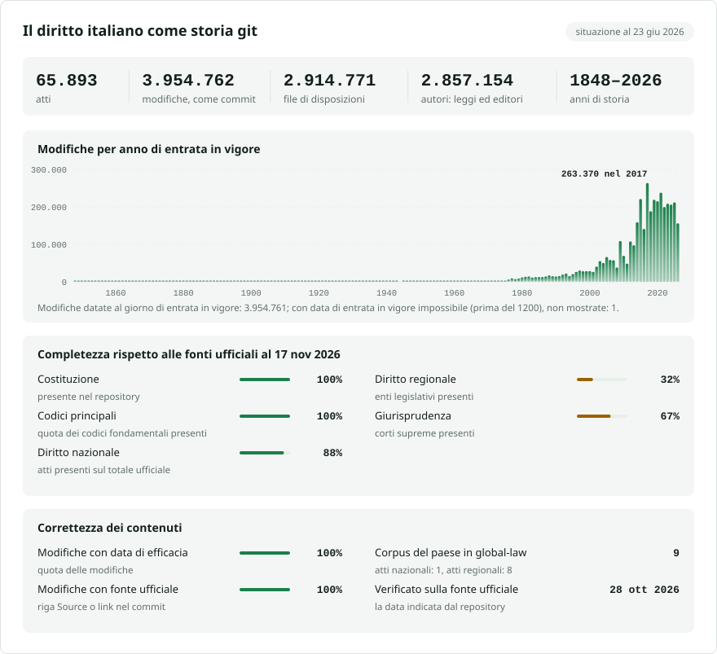

# Italia: storia del diritto in git

**Italiano** · **[Or read it in English](README.en.md)**

<picture>
<source media="(prefers-color-scheme: dark)" srcset="data/it/effort-dark.svg">

</picture>

Il diritto italiano come storia git: un file per articolo, un commit per ogni modifica nel giorno in cui è entrata in vigore, e come autore del commit l'atto che ha apportato la modifica. `git blame` indica l'atto che sta dietro a ogni comma; `git log` elenca ogni modifica di un articolo; scegliendo una data si ottiene il testo vigente in quel giorno.

Fa parte di [lexifina/global-law](https://github.com/lexifina/global-law), un'unica storia git per il diritto di ogni Paese: questo è il diritto nazionale italiano, che global-law legge in `italy/national/acts/`.

**Che cosa contiene ora:** la Costituzione (28 versioni dal 1948) e 54 leggi (le 50 leggi costituzionali e quattro testi più volte modificati) con tutte le versioni che Normattiva pubblica; 22.441 pronunce della Corte costituzionale dal 1956 al 2026 (estremi e link al testo ufficiale) e le loro 46.607 massime ufficiali per intero, dagli open data della Corte (CC BY-SA 3.0), in [`giurisprudenza/corte-costituzionale/`](giurisprudenza/corte-costituzionale/). I codici fondamentali (civile, penale, di procedura civile e penale) non sono ancora presenti: le loro fonti ufficiali (Normattiva, Gazzetta Ufficiale) sono bloccate o richiedono una sessione. [`REPRODUCE.md`](REPRODUCE.md) elenca ogni atto con la sua cartella e le sue versioni; [`atti.csv`](atti.csv) elenca gli atti modificativi con tutte le loro date.

Ogni atto è in `<tipo>/<anno>/<numero>/`, un file per articolo (`legge/1970/300/art-018.md` è l'art. 18 dello Statuto dei lavoratori, Legge 20 maggio 1970, n. 300); la Costituzione è in [`costituzione/`](costituzione/), con le disposizioni transitorie e finali in `costituzione/allegati/`.

Il testo è in italiano, come lo pubblica Normattiva, con i segni `(( ))` attorno alle parole modificate e le sue note di aggiornamento. Una traduzione inglese non fa parte di questo archivio.

## Domande come comandi git

| Domanda | Comando |
| --- | --- |
| Tutte le modifiche all'art. 18 dello Statuto dei lavoratori | `git log -p --word-diff -- legge/1970/300/art-018.md` |
| Quale atto ha scritto ciascuna riga dell'art. 18? | `git blame legge/1970/300/art-018.md` |
| Tutte le versioni dello Statuto dei lavoratori, con il giorno in cui ciascuna è entrata in vigore | `git log --format="%h %(trailers:key=In-force,valueonly,separator=) %an" -- legge/1970/300` |
| L'art. 18 nel testo vigente al 1º gennaio 2012 | `python tools/vigente.py 2012-01-01 legge/1970/300 18` |

**Fuori da git** mettiamo questo archivio anche a disposizione di tutti, gratuitamente:

- **[Chiedi a Claude del diritto italiano](https://global-law.lexifina.com/v1/try_claude?country=italy)**: apre Claude con una prima domanda già pronta.
- **[Chiedi a ChatGPT](https://global-law.lexifina.com/v1/try_chatgpt?country=italy)**: la stessa domanda in ChatGPT.
- **[Cerca nel diritto italiano sul nostro sito](https://lexifina.com/law?country=italy&q=ferie+annuali)**: una ricerca di "ferie annuali", con il testo di ogni disposizione e le sue versioni, senza account.
- **[API REST per sviluppatori](https://global-law.lexifina.com/v1/search_law?query=ferie+annuali&jurisdiction=italy)**: la stessa ricerca in JSON, senza chiave. La documentazione è [qui](https://lexifina.com/api/global-law).

Entrambi gli assistenti leggono l'archivio tramite il connettore gratuito Global law (MCP, `https://global-law.lexifina.com/mcp`); la prima volta la chat ti dà il link per aggiungerlo. Chiedi in italiano o in inglese.

**Ospitalo tu stesso, facilmente.** Bastano git e Python, e gli strumenti girano sul tuo computer:

```sh
git clone --depth 1 https://github.com/lexifina/global-law && cd global-law
python3 tools/countries.py add italy/national/acts
python3 tools/law.py show 2026-01-01 italy/national/acts/legge/1970/300/art-018.md
```

Aperto in Claude Code, Cursor, VS Code o Codex, il clone avvia anche un server MCP locale con gli stessi strumenti ([MCP.md](https://github.com/lexifina/global-law/blob/main/MCP.md)).

## Date

Ogni commit è datato a mezzogiorno, ora di Roma (Europe/Rome), nel giorno in cui la modifica è entrata in vigore, e riporta quel giorno nel trailer `In-force:` (con `Enacted:` e `Published:`):

- il giorno è quello che Normattiva indica come inizio della versione ("vigenza dal"); se due versioni iniziano lo stesso giorno, il testo di quel giorno è la più recente;
- git non può registrare date anteriori al 1970, perciò i 23 commit entrati in vigore prima (la Costituzione del 1948, le sue revisioni fino al 1967, i primi statuti delle regioni speciali) sono datati 1º gennaio 1970, a un secondo di distanza nell'ordine in cui sono entrati in vigore, con il giorno reale in `In-force:`. Per una data usa `tools/vigente.py`, non `git log --before`.

Ogni modifica è attribuita all'atto indicato dal registro per articolo di Normattiva (`Legge 92/2012`, `D.L. 248/2007`), con un indirizzo che non può esistere (`legge-2012-92@normattiva.invalid`); sono autori anche le sentenze della Corte costituzionale che hanno eliminato parole (`Corte costituzionale, sentenza 59/2021`), e un decreto-legge è indicato con il proprio numero anche quando la modifica è stata fatta dalla sua legge di conversione. Le modifiche che nessun registro spiega (6 commit), o che due atti avrebbero potuto apportare (4, che li indicano nei trailer `Candidate:`), sono registrate da `Normattiva (IPZS)` e non attribuite ad alcun atto.

## Come viene verificato

- `tools/check_repo.py` rilegge da git ogni versione di ogni atto nel giorno in cui è entrata in vigore e la confronta con il file Akoma Ntoso di Normattiva per quella versione, byte per byte con il testo che ne deriva e parola per parola con ogni parola dell'XML: 340 versioni, 0 differenze.
- Una seconda costruzione dagli stessi dati in una cartella vuota ha dato lo stesso hash per ogni commit e ogni tag.
- `tools/test_repo.py` verifica che blame, lo strumento per le date, i tag e i trailer `In-force:` funzionino. I risultati sono in [`REPRODUCE.md`](REPRODUCE.md).
- [vulnerabilities/](vulnerabilities/): possibili errori di redazione in questo diritto, trovati dai rilevatori di global-law e controllati a mano. Non ancora eseguito.

## Che cosa non mostra

- **La maggior parte del diritto italiano.** Ci sono solo questi 55 atti: non i codici (civile, penale, di procedura) né altre leggi. La stessa costruzione funziona per qualsiasi atto esportato da Normattiva Open Data.
- **Le modifiche successive al 28 ottobre 2026**, il giorno in cui i dati sono stati scaricati.
- **Le versioni che Normattiva non pubblica.** Ogni atto parte dal testo come pubblicato (l'"originale").
- **I cambiamenti di significato senza cambiamento delle parole**: una sentenza, una norma transitoria altrove o un'interpretazione successiva possono cambiare il significato di una disposizione; le note di Normattiva ne registrano alcuni.
- **Il diritto regionale e la giurisprudenza.** Le leggi delle regioni sono nei loro repository in global-law (`italy/<region>/acts/`); le sentenze della Corte costituzionale compaiono solo dove hanno cambiato il testo.

## Fonti

| Fonte | Tipo | Versioni precedenti | Note |
| --- | --- | --- | --- |
| [Normattiva Open Data](https://dati.normattiva.it) (Istituto Poligrafico e Zecca dello Stato) | Testo consolidato "in multivigenza", Akoma Ntoso e JSON | sì, ogni versione a partire dall'originale | Il JSON fornisce il registro per articolo degli atti modificativi; non è il testo ufficiale, che è quello della Gazzetta Ufficiale a mezzo stampa |

## Licenza

Vedi [`LICENSE`](LICENSE). I dati provengono da Normattiva Open Data con licenza CC BY 4.0, che dal 1º gennaio 2026 copre ogni atto su Normattiva in tutte le sue versioni; attribuzione: **Fonte: Normattiva (www.normattiva.it) - Istituto Poligrafico e Zecca dello Stato S.p.A., dati.normattiva.it, licenza CC BY 4.0. Testo non ufficiale e a titolo gratuito.** L'intero repository è rilasciato con licenza CC BY 4.0 con la stessa attribuzione.

Nessun modello di IA ha scritto o modificato testo normativo; gli script sono stati scritti da un modello di IA (vedi [`REPRODUCE.md`](REPRODUCE.md)).

Questa è una traduzione della versione inglese ([README.en.md](README.en.md)); in caso di differenze, prevale la versione inglese.

## Visualizzazioni

- [visualisations/](visualisations/): grafici tratti da questo repository. Non ancora disegnati.

## Per saperne di più

Dal repository [lexifina/global-law](https://github.com/lexifina/global-law) (pagine in inglese):

- [FEATURES.md](https://github.com/lexifina/global-law/blob/main/FEATURES.md): tutte le funzionalità e ciò che ogni corpus deve supportare (`git blame`, `law.py`, strumenti MCP)
- [FAQ.md](https://github.com/lexifina/global-law/blob/main/FAQ.md): domande e risposte · [CONTRIBUTING.md](https://github.com/lexifina/global-law/blob/main/CONTRIBUTING.md): proporre una modifica · [MCP.md](https://github.com/lexifina/global-law/blob/main/MCP.md): server MCP · [REPRODUCE.md](https://github.com/lexifina/global-law/blob/main/REPRODUCE.md): come è stato realizzato · [CHANGELOG.md](https://github.com/lexifina/global-law/blob/main/CHANGELOG.md)
- [FRESHNESS.md](https://github.com/lexifina/global-law/blob/main/FRESHNESS.md): quanto è aggiornato ogni corpus · [Monitoraggio](https://github.com/lexifina/global-law/tree/main/monitoring): se gli aggiornamenti funzionano · [WATCHING.md](https://github.com/lexifina/global-law/blob/main/WATCHING.md): come ogni fonte ufficiale viene controllata per individuare le modifiche
- [performance/](https://github.com/lexifina/global-law/tree/main/performance): quanto sono veloci gli strumenti, misurato
- [visualisations/](https://github.com/lexifina/global-law/tree/main/visualisations): grafici e collegamenti attraverso il diritto di tutto il mondo
- [Vulnerabilità](https://github.com/lexifina/global-law/tree/main/vulnerabilities): errori nei testi così come sono stati pubblicati
