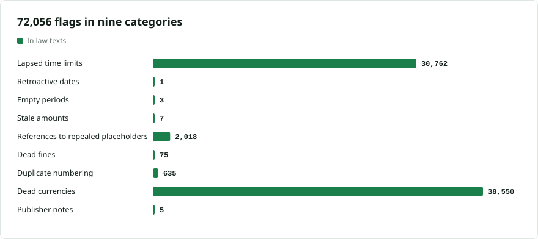

# Vulnerabilities in Italian law

[Italiano](README.md) · **English**

<picture>
<source media="(prefers-color-scheme: dark)" srcset="img/flags-by-category-dark.svg">

</picture>

The vulnerability detectors from [lexifina/global-law](https://github.com/lexifina/global-law/tree/main/vulnerabilities) look for mechanical mistakes in legislation: a rule applying "until" a date that has passed, a time limit extended only after it had run out, an amount changed in one provision but still standing in another, a reference to an article that has been repealed. global-law's published list (9 November 2026) covered Italy with 169 flags (8 lapsed time limits, 3 dead currencies, 158 references to repealed placeholders), read from an earlier copy of this repository (commit `2edcc48` of 6 November 2026, 244 commits: the Constitution and the acts held with every version). This is a run over this repository only, as it stood at commit [`4b8df16`](https://github.com/lexifina/italy-law/commit/4b8df166401b3a58438d486cf0a59b8deed6b716) on 17 November 2026: 4,052,201 commits, the 74,238 acts of `normativa/` and the Constitution.

**In short:** the detectors raised 72,056 flags, almost all of them lapsed time limits (30,762) and amounts in dead currencies, nearly all lire (38,550). A language model reviewed the 51 strongest, arguing each one for and against; 5 survived. Checked by hand, none of the 5 is a mistake in Italian law: three are transitional rules that ran out as planned (two of them quoted in Normattiva's update notes), and two are amounts that still stand only in the amending acts that once wrote them. The hand check did find three problems in the record itself, below: four acts published at the end of December whose entry into force Normattiva dates a year too early (Law No. 543 of 23 December 1988 "in force" on 14 January 1988), the first paragraph of Article 628 of the Codice penale (robbery), whose text here still gives the penalty of 1930 although its notes record that Law No. 103/2017 and Law No. 36/2019 replaced it, and 896 acts held twice, among them the Codice penale and the Codice di procedura civile, whose 1,007 flags in common are counted once. Most acts are held only in their text in force, one commit each, so the detectors that compare versions found little: no repeal gap, same-day conflict or reference to a deleted provision. Later, this will be formalised in Lean, similar to our work on [the US tax code](https://lexifina.com/blog/formalizing-the-us-tax-code) and [US case law](https://lexifina.com/blog/formalizing-all-us-case-law-in-lean).

A flag is a prompt to look, not legal advice, and nothing here has been tested in court.

## Flags by category

| Category | What it looks for | Flags | In law texts | Reviewed | Survived review |
| --- | --- | ---: | ---: | ---: | ---: |
| Lapsed time limits | Text still applying a rule "until" a date that has passed | 30,762 | 30,762 | 40 | 3 |
| Retroactive or pre-publication dates | A rule in force before it was made or published | 1 | 1 | 1 | 0 |
| Empty periods | A time limit extended by an act that took effect after it had run out | 3 | 3 | 3 | 0 |
| Stale amounts | An amount changed in one place but still standing elsewhere | 7 | 7 | 7 | 2 |
| References to repealed placeholders | A provision citing an article whose text is only "abrogato" or "soppresso" | 2,018 | 2,018 | 0 | 0 |
| Dead fines | A penalty for breaching an article that has been repealed | 75 | 75 | 0 | 0 |
| Duplicate numbering | Two units with the same number in one act | 635 | 635 | 0 | 0 |
| Dead currencies | Amounts in currencies no longer in use | 38,550 | 38,550 | 0 | 0 |
| Publisher notes | Notes that an amendment could not be carried out | 5 | 5 | 0 | 0 |

"In law texts" counts every file that was read: the acts in `normativa/` (laws, decree-laws, legislative decrees, presidential, royal and ministerial decrees, and the rest) and the Constitution. The detectors read only these two folders at the commit read. This repository also holds 2,777,870 files of parliamentary records (`parlamento/`), 1,169,780 court decisions (`giurisprudenza/`), 938 competition-authority decisions (`autorita/`) and 5,465 records of EU transposition measures (`eu-nim/`): none of them is law, together they are 12.4 GB of text, and the detectors that read every file at once could not hold them in memory; they were not scanned, so this list has no flags outside the law. The history the detectors read is the whole of it: the 75,583 commits without a `Kind:` trailer count as law. For nearly every act that is one commit with its text in force ("testo vigente", dated by the day its current version took effect); only the Constitution, the constitutional laws, four statutes and the four main codes have every version. So the detectors that compare versions can only work on those acts: repeal gaps, same-day conflicts and references to deleted provisions found nothing (the changes to the codes are all committed by Normattiva (IPZS), so no two acts can meet on one day, and a repealed article keeps its file with "((ARTICOLO ABROGATO ...))"), stale amounts and empty periods were found only in the codes, and the one retroactive date gathers the 30 commits of text in force whose day precedes the act's publication. Each article file holds the article and, after a line of dashes, Normattiva's update notes ("AGGIORNAMENTO"), which quote amending and transitional provisions; the detectors read them as text: 4,440 lapsed time limits, 1,967 amounts in dead currencies, 42 references and one dead fine are there. The search for lapsed time limits reads the Italian forms "fino al", "sino al", "entro il", "non oltre il", "a tutto il", "prorogato al" and the end of a period ("dal 1° luglio 2023 al 30 settembre 2023"); it does not read a month or a year without a day ("entro il mese di dicembre 2020") nor a relative term ("entro trenta giorni"). With the fixes for Italian (in [tools/](tools/README.md)), references to repealed placeholders went from 6,812 to 2,101 (2,238 of them were the table of contents of `struttura.md`, which points each chapter to its first article), dead fines from 132 to 79 and dead currencies from 39,033 to 38,899.

*Edge cases: the 5 flags that survived the review, grouped by what they turned out to be, and what the other flags are, in [EDGE-CASES.en.md](EDGE-CASES.en.md).*

## Problems found in this repository

- **Entry into force a year too early.** For four acts published at the end of December, Normattiva gives a day of entry into force in the year of publication instead of the next, and the `In-force:` trailer and the commit's date follow it: Law No. 543 of 23 December 1988, published on 30 December 1988, "Entrata in vigore della legge: 14/1/1988" ([intestazione](https://github.com/lexifina/italy-law/blob/4b8df166401b3a58438d486cf0a59b8deed6b716/normativa/legge/1988/543/intestazione.md)); Presidential Decree No. 305 of 14 October 2004, published on 23 December 2004, "7/1/2004"; Decree No. 239 of 14 November 2007, published on 20 December 2007, "4/1/2007"; Decree No. 241 of 12 November 2007, published on 22 December 2007, "6/1/2007". The fifteenth day after publication falls in January of the next year. Of the 30 commits of text in force dated before their act's publication, the other 26 were not checked one by one; among them, the heading of Royal Decree No. 401 of 29 May 1941 gives 11 June 1940 as its entry into force, except for Part V.
- **Article 628 of the Codice penale (robbery), first paragraph,** reads in both copies "e' punito con la reclusione da tre a dieci anni e con la multa da lire cinquemila a ventimila" ([art-628.md](https://github.com/lexifina/italy-law/blob/4b8df166401b3a58438d486cf0a59b8deed6b716/normativa/regio-decreto/1930/1398/allegati/codice-penale/art-0500-0999/art-628.md#L5)), while its update notes record that Law No. 103 of 23 June 2017 (Article 1(8)(a)) replaced "e' punito con la reclusione da tre a dieci anni e con la multa da euro 516 a euro 2.065" with "da quattro a dieci anni ... da euro 927 a euro 2.500", and Law No. 36 of 26 April 2019 (Article 6(1)(a)) "quattro" with "cinque". The words those acts replaced are not in the text, so the text that `git blame` and `tools/vigente.py` give for that paragraph is not the text in force; this is the text as Normattiva exports it.
- **Acts held twice.** 901 act folders have a second folder with the same number and the codice redazionale added (`normativa/regio-decreto/1930/1398-030u1398/` beside `1398/`); in 896 the title, number and date are the same: the Codice penale, the Codice di procedura civile, the Codice in materia di protezione dei dati personali (Legislative Decree No. 196/2003), 792 royal decrees and others. 170 of the pairs are identical; in the rest the text in force comes from two sources. A flag that both copies have is counted once, in the first (1,007 flags); the other 5 folders are different acts with the same number (royal decrees of the supplementary series, numbered in Roman numerals).
- **Changes to the four codes credited to no act.** The 1,157 commits that change the Codice civile, the Codice penale, the Codice di procedura civile and the Codice di procedura penale are committed by Normattiva (IPZS); 656 of them name the probable amending act only in an `Amending-act-candidate:` trailer. `git blame` on a code therefore names no amending act, unlike the other acts held with every version.

## Files

| File | What it holds |
| --- | --- |
| [data/flags.csv](data/flags.csv) | Every flag, one row per provision and issue |
| [data/reviewed.csv](data/reviewed.csv) | The 51 flags the model reviewed, with its verdict and reason |
| [data/by_category.csv](data/by_category.csv) | The counts in the table above |
| [tools/](tools/) | The scripts that made this run |

Columns: `category` and `category_it` (the category in English and Italian), `detector`, `kind` (`law` or `other`), `path` (the file in this repository), `date` (the date the flag turns on), `reference` (the act or line involved), `summary`, `score` (the detector's ranking, 0 to 1), `review` (`artefact`, `lawful` or `candidate_defect`), `survives_rebuttal`, `review_note` (the model's reason, in English), `url` (the file at the commit that was read; for a retroactive date, the commit).

## How it was made

- **Detectors:** global-law's [vulnerabilities/scripts](https://github.com/lexifina/global-law/tree/main/vulnerabilities/scripts), with the fixes in [tools/](tools/README.md) (among them `patch_it.py` and `patch_it2.py`, the fixes for Italian and for a repository of this size), run on this repository at commit `4b8df16`. global-law replays this repository only up to an earlier commit, so the history table the detectors read was built from this repository's own commits (the author and the `In-force` and `Kind` trailers). The act folders moved to `normativa/` in the commit read, so every earlier path was mapped to its folder today (`data/paths.json`). The language of the corpus is Italian.
- **Model review:** gpt-5.4-mini, the 40 strongest flags per category and, for lapsed time limits, also the 40 strongest in law texts, which here are the same 40; one pass says whether a flag is real, a second argues that it is not. Empty periods use global-law's own review for that category, on all 3, followed by the same second pass. Where a flag was reviewed twice, the later review is kept. The model does not review references to repealed placeholders, dead fines, duplicate numbering, dead currencies or publisher notes. global-law's own list used a different model.
- **Hand check:** the 5 survivors and the 3 empty periods were read in this repository's texts and history, with the amending acts where this repository holds them (Laws No. 103/2017 and No. 36/2019, Legislative Decree No. 285/2006, Decree-Law No. 118/2021), and a sample of the other categories (40 references to repealed placeholders, 20 dead fines, 20 lapsed time limits, the duplicate numbers and all publisher notes). The texts were not compared with the Gazzetta Ufficiale.

To report a correction, open an issue with the provision and an official source.

## Licence

The lists and notes are Lexifina's, released under CC BY 4.0 like the rest of this repository. Quoted law text is Normattiva's, under CC BY 4.0: Fonte: Normattiva (www.normattiva.it) - Istituto Poligrafico e Zecca dello Stato S.p.A., dati.normattiva.it, licenza CC BY 4.0. Testo non ufficiale e a titolo gratuito. See [LICENSE](../LICENSE).
