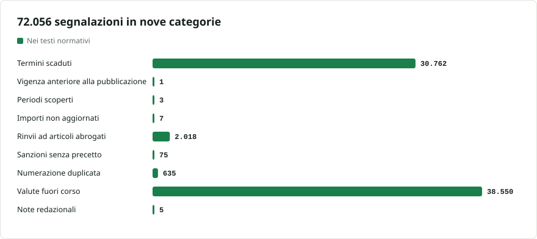

# Vulnerabilità nel diritto italiano

**Italiano** · [English](README.en.md)

<picture>
<source media="(prefers-color-scheme: dark)" srcset="img/flags-by-category-dark.it.svg">

</picture>

I rilevatori di vulnerabilità di [lexifina/global-law](https://github.com/lexifina/global-law/tree/main/vulnerabilities) cercano errori meccanici nella legislazione: una norma che si applica "fino al" giorno ormai trascorso, un termine prorogato solo dopo la sua scadenza, un importo modificato in una disposizione ma rimasto invariato in un'altra, un rinvio a un articolo abrogato. L'elenco pubblicato da global-law (9 novembre 2026) contava per l'Italia 169 segnalazioni (8 termini scaduti, 3 valute fuori corso, 158 rinvii ad articoli abrogati), tratte da una copia precedente di questo repository (il commit `2edcc48` del 6 novembre 2026, con 244 commit: la Costituzione e gli atti presenti in tutte le loro versioni). Questa è un'analisi del solo repository, nello stato del commit [`4b8df16`](https://github.com/lexifina/italy-law/commit/4b8df166401b3a58438d486cf0a59b8deed6b716) del 17 novembre 2026: 4.052.201 commit, i 74.238 atti di `normativa/` e la Costituzione.

**In breve:** i rilevatori hanno prodotto 72.056 segnalazioni, quasi tutte termini scaduti (30.762) e importi in valute fuori corso, per lo più lire (38.550). Un modello linguistico ha esaminato le 51 più rilevanti, argomentando per ciascuna a favore e contro; ne sono rimaste 5. Verificata a mano, nessuna delle 5 è un errore del diritto italiano: tre sono norme transitorie esauritesi come previsto (due delle quali riportate nelle note di aggiornamento di Normattiva) e due sono importi che restano soltanto negli atti modificativi che a suo tempo li introdussero. La verifica a mano ha invece rilevato tre problemi nell'archivio stesso, descritti più avanti: quattro atti pubblicati a fine dicembre per i quali Normattiva indica l'entrata in vigore con un anno di anticipo (la Legge 23 dicembre 1988, n. 543, "in vigore" dal 14 gennaio 1988); il primo comma dell'articolo 628 del codice penale (rapina), il cui testo riporta ancora la pena del 1930, benché le note registrino che la Legge n. 103/2017 e la Legge n. 36/2019 l'hanno sostituita; e 896 atti presenti due volte, tra cui il codice penale e il codice di procedura civile, le cui 1.007 segnalazioni comuni sono contate una sola volta. La maggior parte degli atti è presente soltanto nel testo vigente, con un unico commit, sicché i rilevatori che confrontano le versioni hanno trovato poco: nessun vuoto dopo l'abrogazione, nessuna modifica dello stesso giorno, nessun rinvio a disposizioni soppresse. In seguito tutto ciò sarà formalizzato in Lean, come il nostro lavoro sul [codice tributario degli Stati Uniti](https://lexifina.com/blog/formalizing-the-us-tax-code) e sulla [giurisprudenza statunitense](https://lexifina.com/blog/formalizing-all-us-case-law-in-lean).

Una segnalazione è un invito a esaminare il testo, non una consulenza legale, e nulla di quanto qui esposto è stato sottoposto a un giudice.

## Segnalazioni per categoria

| Categoria | Che cosa cerca | Segnalazioni | Nei testi normativi | Esaminate | Confermate dopo l'esame |
| --- | --- | ---: | ---: | ---: | ---: |
| Termini scaduti | Un testo che applica ancora una norma "fino al" giorno ormai trascorso | 30.762 | 30.762 | 40 | 3 |
| Vigenza anteriore alla pubblicazione | Una norma in vigore prima di essere adottata o pubblicata | 1 | 1 | 1 | 0 |
| Periodi scoperti | Un termine prorogato da un atto entrato in vigore dopo la sua scadenza | 3 | 3 | 3 | 0 |
| Importi non aggiornati | Un importo modificato in una disposizione ma rimasto in un'altra | 7 | 7 | 7 | 2 |
| Rinvii ad articoli abrogati | Una disposizione che rinvia a un articolo il cui testo è soltanto "abrogato" o "soppresso" | 2.018 | 2.018 | 0 | 0 |
| Sanzioni senza precetto | Una sanzione per la violazione di un articolo abrogato | 75 | 75 | 0 | 0 |
| Numerazione duplicata | Due partizioni con lo stesso numero nello stesso atto | 635 | 635 | 0 | 0 |
| Valute fuori corso | Importi in valute non più in uso | 38.550 | 38.550 | 0 | 0 |
| Note redazionali | Note secondo cui una modifica non ha potuto essere inserita nel testo | 5 | 5 | 0 | 0 |

"Nei testi normativi" comprende ogni file letto: gli atti di `normativa/` (leggi, decreti-legge, decreti legislativi, decreti del Presidente della Repubblica, regi decreti, decreti ministeriali e gli altri) e la Costituzione. I rilevatori hanno letto, al commit esaminato, soltanto queste due cartelle. Il repository contiene anche 2.777.870 file di atti e lavori parlamentari (`parlamento/`), 1.169.780 provvedimenti giurisdizionali (`giurisprudenza/`), 938 provvedimenti dell'Autorità garante della concorrenza e del mercato (`autorita/`) e 5.465 schede sulle misure di recepimento delle direttive UE (`eu-nim/`): nessuno di questi è diritto, insieme occupano 12,4 GB di testo e i rilevatori che leggono tutti i file in una volta non riuscivano a tenerli in memoria; non sono stati esaminati, quindi l'elenco non contiene segnalazioni fuori dai testi normativi. La storia letta dai rilevatori è invece completa: contano come diritto i 75.583 commit privi del trailer `Kind:`. Per quasi ogni atto si tratta di un unico commit con il testo vigente, datato al giorno in cui ha preso effetto la versione attuale; tutte le versioni ci sono soltanto per la Costituzione, le leggi costituzionali, quattro leggi e i quattro codici principali. I rilevatori che confrontano le versioni possono quindi lavorare solo su questi atti: i vuoti dopo l'abrogazione, le modifiche dello stesso giorno e i rinvii a disposizioni soppresse non hanno dato risultati (le modifiche ai codici sono tutte registrate da Normattiva (IPZS), sicché due atti non possono incontrarsi nello stesso giorno, e un articolo abrogato conserva il suo file con "((ARTICOLO ABROGATO ...))"); gli importi non aggiornati e i periodi scoperti si trovano soltanto nei codici; l'unica vigenza anteriore alla pubblicazione raccoglie i 30 commit di testo vigente datati prima della pubblicazione dell'atto. Il file di ciascun articolo contiene l'articolo e, dopo una riga di trattini, le note di aggiornamento di Normattiva ("AGGIORNAMENTO"), che riportano disposizioni modificative e transitorie; i rilevatori le leggono come testo: vi si trovano 4.440 termini scaduti, 1.967 importi in valute fuori corso, 42 rinvii e una sanzione. La ricerca dei termini scaduti legge "fino al", "sino al", "entro il", "non oltre il", "a tutto il", "prorogato al" e la fine di un periodo ("dal 1° luglio 2023 al 30 settembre 2023"); non legge un mese o un anno senza giorno ("entro il mese di dicembre 2020") né i termini relativi ("entro trenta giorni"). Con le correzioni per l'italiano (in [tools/](tools/README.md)) i rinvii ad articoli abrogati sono scesi da 6.812 a 2.101 (2.238 erano l'indice di `struttura.md`, che rinvia al primo articolo di ogni capo), le sanzioni senza precetto da 132 a 79 e le valute fuori corso da 39.033 a 38.899.

*Casi limite: le 5 segnalazioni rimaste dopo l'esame, raggruppate secondo ciò che si sono rivelate, e la natura delle altre segnalazioni, in [EDGE-CASES.md](EDGE-CASES.md).*

## Problemi riscontrati in questo repository

- **Entrata in vigore con un anno di anticipo.** Per quattro atti pubblicati a fine dicembre Normattiva indica un giorno di entrata in vigore nell'anno della pubblicazione anziché nel successivo, e il trailer `In-force:` e la data del commit lo seguono: la Legge 23 dicembre 1988, n. 543, pubblicata il 30 dicembre 1988, "Entrata in vigore della legge: 14/1/1988" ([intestazione](https://github.com/lexifina/italy-law/blob/4b8df166401b3a58438d486cf0a59b8deed6b716/normativa/legge/1988/543/intestazione.md)); il D.P.R. 14 ottobre 2004, n. 305, pubblicato il 23 dicembre 2004, "7/1/2004"; il Decreto 14 novembre 2007, n. 239, pubblicato il 20 dicembre 2007, "4/1/2007"; il Decreto 12 novembre 2007, n. 241, pubblicato il 22 dicembre 2007, "6/1/2007". Il quindicesimo giorno dalla pubblicazione cade nel gennaio dell'anno successivo. Degli altri 26 commit di testo vigente datati prima della pubblicazione dell'atto nessuno è stato verificato singolarmente; tra questi, l'intestazione del R.D. 29 maggio 1941, n. 401, indica come entrata in vigore l'11 giugno 1940, salvo la Parte V.
- **Articolo 628 del codice penale (rapina), primo comma.** In entrambe le copie si legge "e' punito con la reclusione da tre a dieci anni e con la multa da lire cinquemila a ventimila" ([art-628.md](https://github.com/lexifina/italy-law/blob/4b8df166401b3a58438d486cf0a59b8deed6b716/normativa/regio-decreto/1930/1398/allegati/codice-penale/art-0500-0999/art-628.md#L5)), mentre le note di aggiornamento registrano che la Legge 23 giugno 2017, n. 103 (articolo 1, comma 8, lettera a)) ha sostituito le parole "e' punito con la reclusione da tre a dieci anni e con la multa da euro 516 a euro 2.065" con "da quattro a dieci anni ... da euro 927 a euro 2.500", e la Legge 26 aprile 2019, n. 36 (articolo 6, comma 1, lettera a)) "quattro" con "cinque". Le parole sostituite da quegli atti non compaiono nel testo, perciò il testo che `git blame` e `tools/vigente.py` restituiscono per quel comma non è quello vigente; è il testo così come lo esporta Normattiva.
- **Atti presenti due volte.** 901 cartelle di atti hanno una seconda cartella con lo stesso numero e il codice redazionale (`normativa/regio-decreto/1930/1398-030u1398/` accanto a `1398/`); in 896 casi titolo, numero e data coincidono: il codice penale, il codice di procedura civile, il codice in materia di protezione dei dati personali (D.Lgs. n. 196/2003), 792 regi decreti e altri atti. 170 coppie sono identiche; nelle altre il testo vigente proviene da due fonti diverse. Una segnalazione presente in entrambe le copie è contata una sola volta, nella prima (1.007 segnalazioni); le altre 5 cartelle sono atti diversi con lo stesso numero (regi decreti della parte supplementare, numerati in cifre romane).
- **Modifiche ai quattro codici non attribuite ad alcun atto.** I 1.157 commit che modificano il codice civile, il codice penale, il codice di procedura civile e il codice di procedura penale sono registrati da Normattiva (IPZS); 656 indicano l'atto modificativo probabile soltanto nel trailer `Amending-act-candidate:`. `git blame` su un codice non indica quindi alcun atto modificativo, a differenza degli altri atti presenti in tutte le versioni.

## File

| File | Contenuto |
| --- | --- |
| [data/flags.csv](data/flags.csv) | Tutte le segnalazioni, una riga per disposizione e questione |
| [data/reviewed.csv](data/reviewed.csv) | Le 51 segnalazioni esaminate dal modello, con il suo giudizio e la motivazione |
| [data/by_category.csv](data/by_category.csv) | I numeri della tabella qui sopra |
| [tools/](tools/) | Gli script che hanno prodotto questa analisi |

Colonne: `category` e `category_it` (la categoria in inglese e in italiano), `detector`, `kind` (`law` oppure `other`), `path` (il file in questo repository), `date` (la data da cui dipende la segnalazione), `reference` (l'atto o la riga in questione), `summary`, `score` (il punteggio del rilevatore, da 0 a 1), `review` (`artefact`, `lawful` oppure `candidate_defect`), `survives_rebuttal`, `review_note` (la motivazione del modello, in inglese), `url` (il file al commit esaminato; per una vigenza anteriore alla pubblicazione, il commit).

## Come è stato fatto

- **Rilevatori:** gli script di global-law, [vulnerabilities/scripts](https://github.com/lexifina/global-law/tree/main/vulnerabilities/scripts), con le correzioni descritte in [tools/](tools/README.md) (tra cui `patch_it.py` e `patch_it2.py`, le correzioni per l'italiano e per un repository di queste dimensioni), eseguiti su questo repository al commit `4b8df16`. global-law riproduce questo repository solo fino a un commit precedente, perciò la tabella della storia letta dai rilevatori è stata costruita dai commit di questo stesso repository (l'autore e i trailer `In-force` e `Kind`). Nel commit esaminato le cartelle degli atti sono state spostate in `normativa/`, quindi ogni percorso precedente è stato ricondotto alla cartella attuale (`data/paths.json`). La lingua del corpus è l'italiano.
- **Esame del modello:** gpt-5.4-mini, le 40 segnalazioni più rilevanti per categoria e, per i termini scaduti, anche le 40 più rilevanti nei testi normativi, che qui coincidono; un primo passaggio valuta se la segnalazione è fondata, un secondo sostiene che non lo è. I periodi scoperti seguono l'esame proprio di global-law per quella categoria, su tutti e 3, con lo stesso secondo passaggio. Quando una segnalazione è stata esaminata due volte, vale l'esame più recente. Il modello non esamina i rinvii ad articoli abrogati, le sanzioni senza precetto, la numerazione duplicata, le valute fuori corso né le note redazionali. L'elenco di global-law è stato prodotto con un altro modello.
- **Verifica a mano:** le 5 segnalazioni rimaste e i 3 periodi scoperti sono stati letti nei testi e nella storia di questo repository, insieme agli atti modificativi che il repository contiene (Leggi n. 103/2017 e n. 36/2019, D.Lgs. n. 285/2006, D.L. n. 118/2021), così come un campione delle altre categorie (40 rinvii ad articoli abrogati, 20 sanzioni senza precetto, 20 termini scaduti, i casi di numerazione duplicata e tutte le note redazionali). I testi non sono stati confrontati con la Gazzetta Ufficiale.

Per segnalare una correzione, aprite una issue indicando la disposizione e una fonte ufficiale.

## Licenza

Gli elenchi e le note sono di Lexifina e sono rilasciati con licenza CC BY 4.0, come il resto di questo repository. Il testo normativo citato è quello di Normattiva, con licenza CC BY 4.0: Fonte: Normattiva (www.normattiva.it) - Istituto Poligrafico e Zecca dello Stato S.p.A., dati.normattiva.it, licenza CC BY 4.0. Testo non ufficiale e a titolo gratuito. Vedi [LICENSE](../LICENSE).
